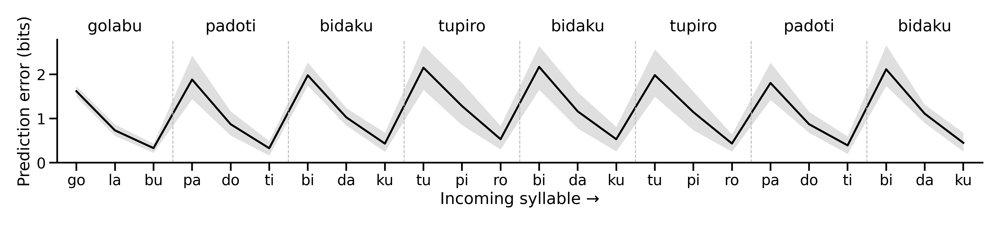

# Prediction error and word boundaries

An Elman recurrent network learns to predict the next syllable in a continuous artificial language. After training, prediction error rises when the stream crosses a word boundary. This is a qualitative computational illustration inspired by [Elman (1990)](https://doi.org/10.1016/0364-0213(90)90002-E), using the words from [Saffran, Aslin & Newport (1996), Experiment 1A](https://doi.org/10.1126/science.274.5294.1926).

## Words and input

| Word | Three syllable tokens |
|---|---|
| **tupiro** | tu · pi · ro |
| **golabu** | go · la · bu |
| **bidaku** | bi · da · ku |
| **padoti** | pa · do · ti |

Each stream contains 45 copies of each word: 180 words / 540 syllables, randomized without immediately repeating the same word. These constraints follow the original study's first artificial language. The original speech familiarization lasted two minutes. Each model now receives **one pass through those 540 symbolic syllables**, with no replay. This matches the nominal stimulus count, not a biological learning rate.

The network sees **12 syllable identities**, not letters. For example:

```text
bi da ku pa do ti go la bu tu pi ro ...
```

There is no special boundary token, word identity input, pause, or hidden-state reset between words. Spaces above separate individual syllables only; they do not encode word boundaries. Word labels and boundaries are retained separately for evaluation and plotting.

Within each word, the next syllable is certain. At a word boundary, any of the other three words can follow, giving a nominal transition probability of 1/3. Finite balanced random streams deviate from exactly 1/3; the measured test-stream transitions are saved in [`results/summary.json`](results/summary.json).

## Prediction error over time



The black line is mean **surprisal in bits**, −log₂ P(the incoming syllable | preceding syllables), across five independently trained models. The gray error band is a **pointwise 95% bootstrap confidence interval for the model mean**, using 10,000 resamples of model seeds. Every model receives just one 540-syllable exposure. No synthetic noise or temporal smoothing is applied. Dashed lines mark boundaries, and the word labels identify each three-syllable chunk. **Boundary-crossing errors appear on the first syllable of the next word.** Error heights vary, and within-word errors remain above zero because the model is only partially trained.

The figure shows eight consecutive words after four warm-up words, selected by a fixed window rather than by model performance. The numerical summary uses the entire held-out 540-syllable stream, excluding only its first syllable because it has no preceding context. See the [standalone figure caption](imgs/pe.caption.md) for the sampling and uncertainty definitions.

<!-- RESULTS_TABLE_START -->
| Transition | Five-model mean (bits) | 95% CI for mean |
|---|---:|---:|
| Across a word boundary | 2.007 | 1.966–2.047 |
| Within a word | 0.719 | 0.611–0.826 |

Each of five independent models receives only one training stream. The numerical summary evaluates the same 179 boundary-crossing and 360 within-word transitions per model. Confidence intervals resample model seeds, preserving each model's paired time points. They describe training variability, not infant variability. The full per-model results remain available in the CSV and JSON files.
<!-- RESULTS_TABLE_END -->

With extensive training, a predictor could approach 0 bits within words and log₂(3) ≈ 1.585 bits across boundaries. This one-pass model remains imperfect. Boundary errors are higher on average because the next word is uncertain. This demonstrates a possible segmentation cue; it does not by itself establish that the model has learned explicit word labels or that infants use this particular network.

## Run locally

Python 3.11 or newer is recommended. From this repository:

```bash
python -m venv .venv
source .venv/bin/activate
python -m pip install -r requirements.txt
python saffran_demo.py
python -m pytest -q
```

The default run uses CPU, five independent model seeds (0–4), and 32 hidden units. **Each model sees one 540-syllable stream once**, yielding 539 next-syllable prediction targets. Adam updates the weights online in chunks of 16 prediction pairs: 34 updates total, with the last 11-pair chunk retained. Hidden state values continue across every chunk; only gradients are detached. A chunk length of 16 avoids synchronizing update timing with three-syllable words. No word-boundary labels or resets are used.

The plot pools all five model seeds, using the same fixed test excerpt as before. Independent models provide a mean and confidence interval, without increasing exposure for any model. The held-out test word order has seed 2026; training word orders use seeds 2³² + model seed. Evaluation freezes weights. No GPU is required.

To run a single model instead (this overwrites result files and produces no across-model confidence interval):

```bash
python saffran_demo.py --seeds 0
```

Rerun the default command to restore the five-model mean, error band, and numerical summary. Outputs:

- [`imgs/pe.png`](imgs/pe.png): 300-DPI figure, with a separate caption.
- [`results/prediction_errors.csv`](results/prediction_errors.csv): target-aligned error, syllable, word, and boundary metadata for every test prediction and model seed.
- [`results/training_loss.csv`](results/training_loss.csv): training loss for every update.
- [`results/summary.json`](results/summary.json): configuration, versions, full test word order, empirical transition probabilities, per-model summaries, and confidence intervals.

The plotting helper and theme are bundled under `plotting/`, so no personal filesystem paths are needed.

## Notebook

[`elman_pytorch.ipynb`](elman_pytorch.ipynb) is the primary, executed notebook. It is self-contained and can also be uploaded to Colab. [Open the GitHub version in Colab](https://colab.research.google.com/github/qihongl/demo-elman-1990/blob/master/elman_pytorch.ipynb).

The notebook is generated from the tested Python source and bundled plotting assets. To refresh it after source changes:

```bash
python tools/build_notebook.py
```

The historical [`elman_pnl.ipynb`](elman_pnl.ipynb) has updated syllable stimuli, but retains its old longer-training protocol. Its PsyNeuLink 0.5.2.1 execution has **not** been validated in a modern environment. Its plot is an in-sample legacy diagnostic. Use the PyTorch demo for the verified one-pass, held-out results.

## Changes from the previous demonstration

The A–Z character chunks have been replaced by Saffran's syllables. The PyTorch implementation now uses the recurrent time axis correctly (`batch_first=True`) and predicts **the next input**, rather than reconstructing the current input. The output is a softmax distribution trained with cross-entropy; the previous notebook used squared reconstruction error. New numerical values are therefore not directly comparable to the old figure. Evaluation uses a separate test stream and plots errors at the target syllable that was predicted.

## References

1. Elman, J. L. (1990). Finding structure in time. *Cognitive Science, 14*(2), 179–211. [DOI](https://doi.org/10.1016/0364-0213(90)90002-E).
2. Saffran, J. R., Aslin, R. N., & Newport, E. L. (1996). Statistical learning by 8-month-old infants. *Science, 274*(5294), 1926–1928. [DOI](https://doi.org/10.1126/science.274.5294.1926), [original paper](https://linguistics.berkeley.edu/~kjohnson/ling290e/saffran_et_al_1996.pdf), especially note 16.
